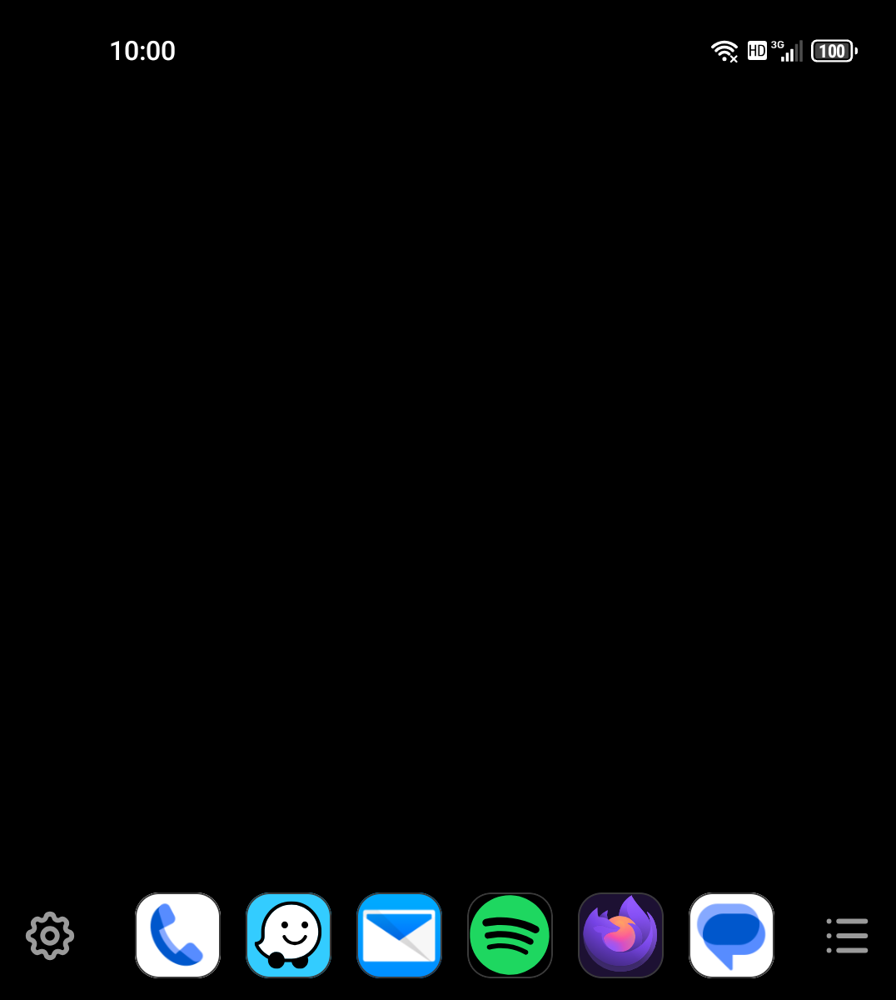
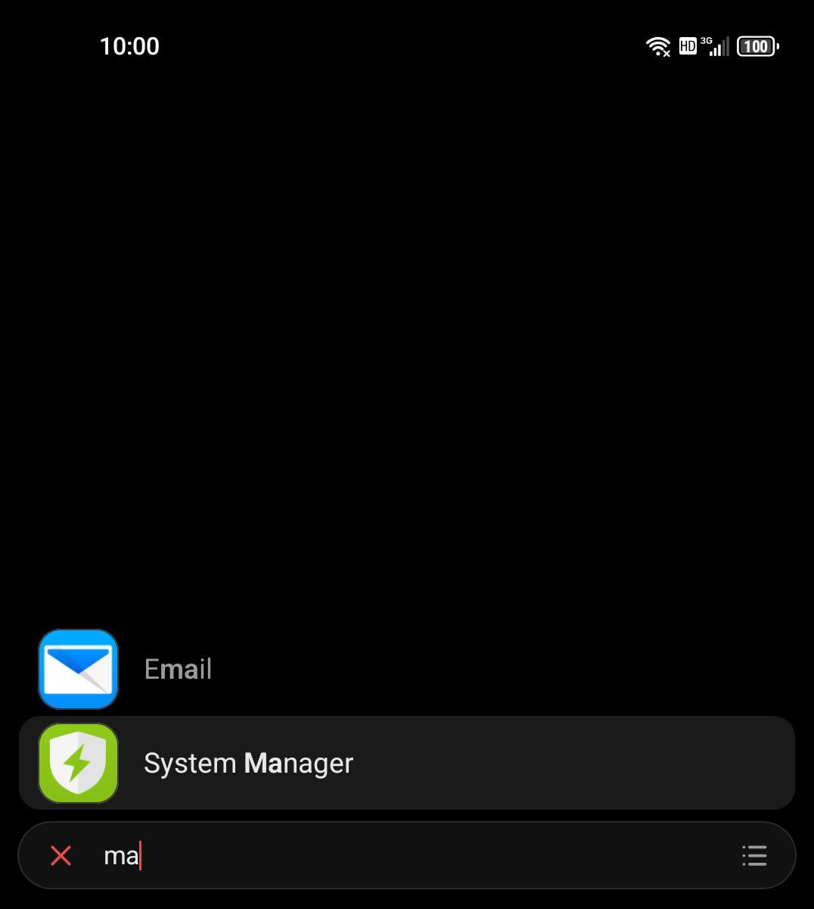
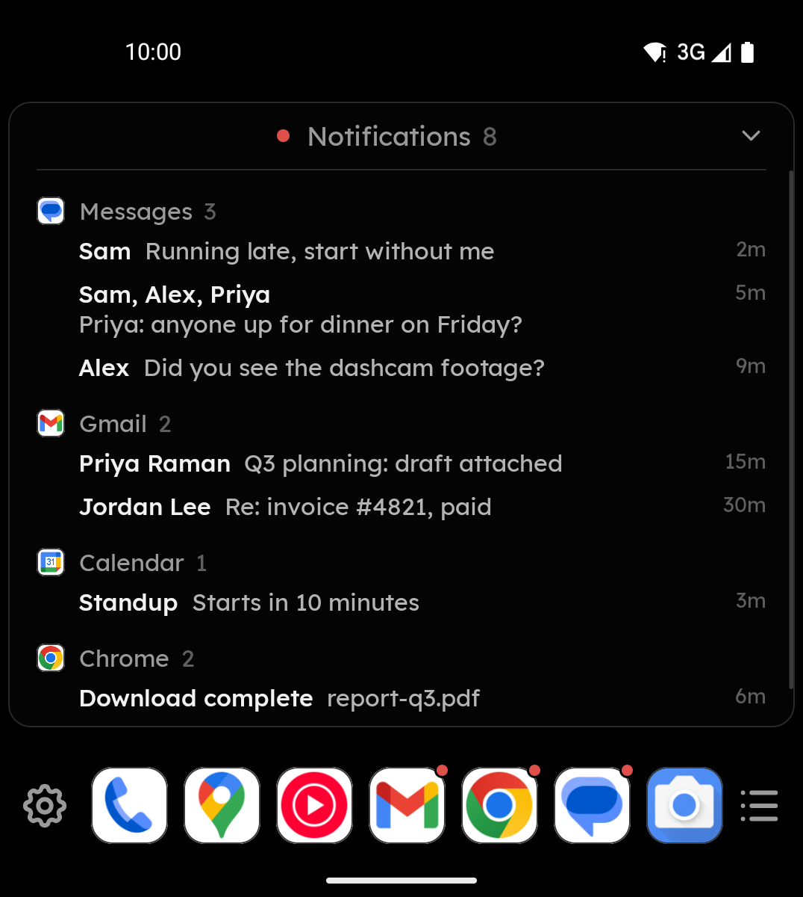
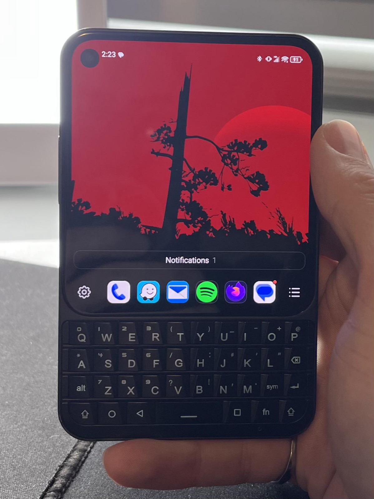
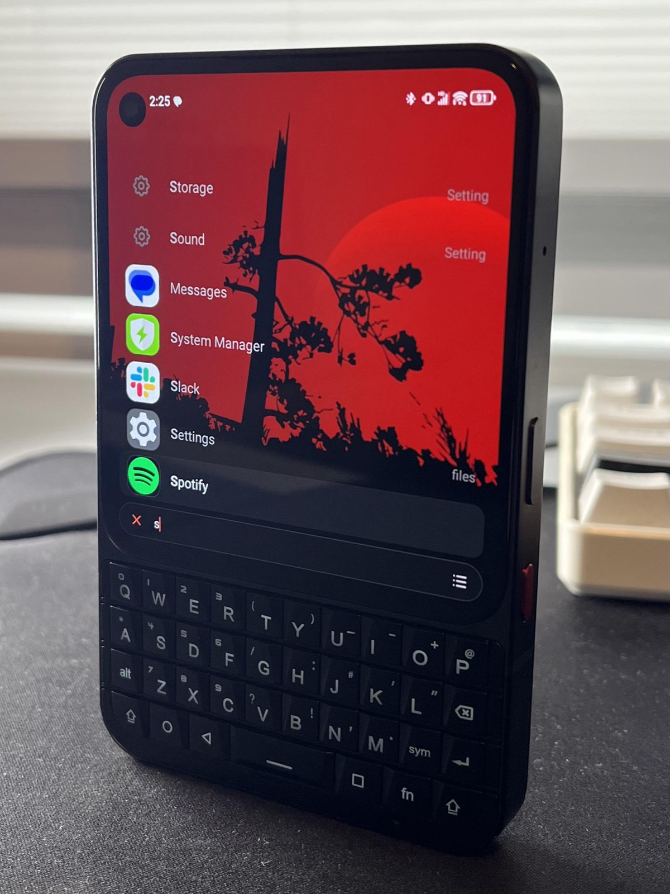
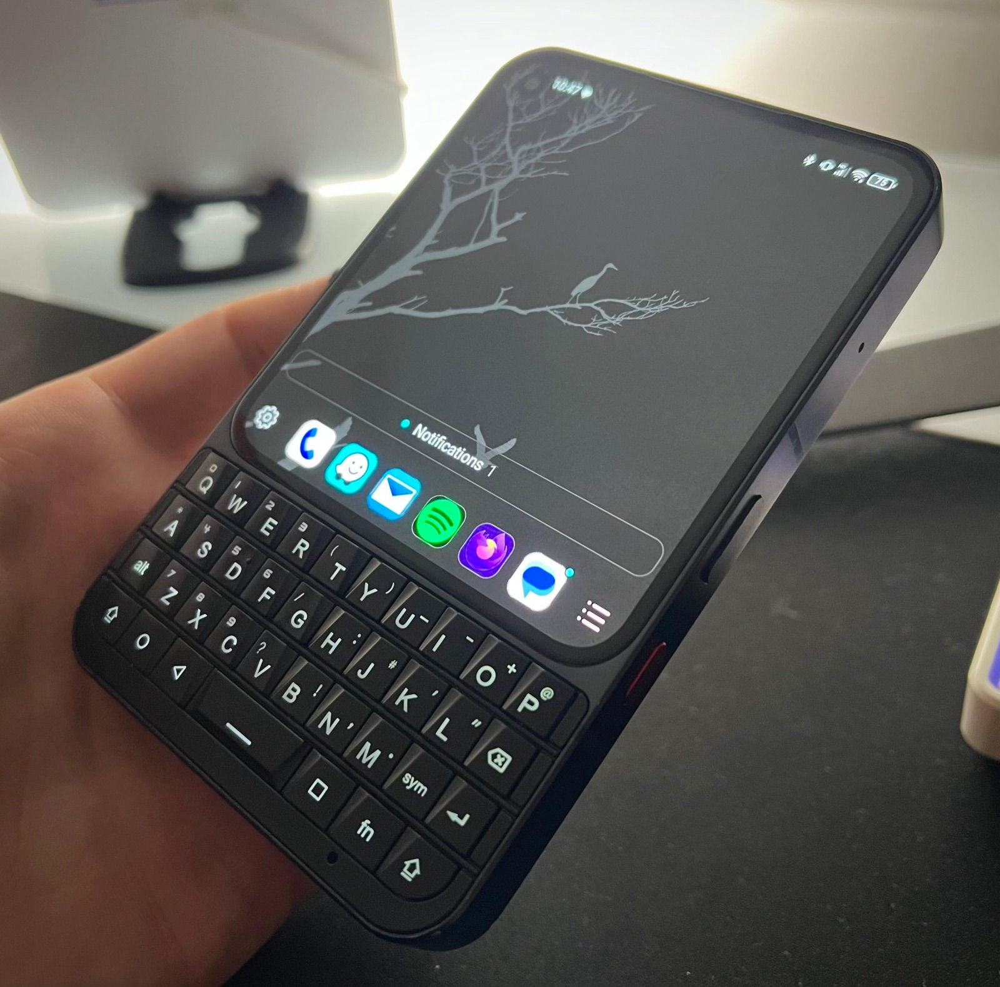
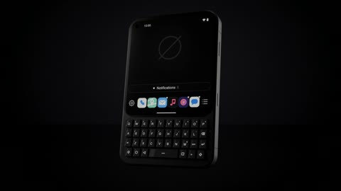
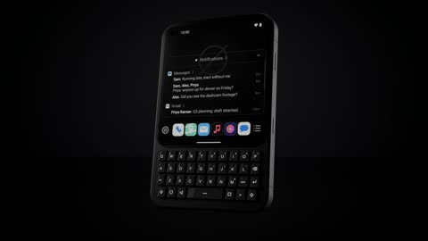
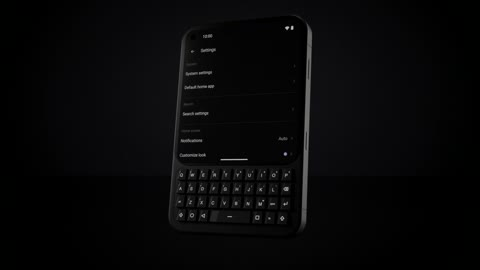

<p align="center">
  
</p>

<h3 align="center">void os</h3>

<p align="center">
  A minimal home screen for keyboard phones.<br>
  <a href="../../releases/latest"><b>Download</b></a>
</p>

<br>

<p align="center">
  
  
  
</p>

<p align="center">
  
  
  
</p>

<br>

### Demo

<p align="center">
  <a href="../../releases/latest/download/voidos-demo-mono-23s-reddit.mp4"></a>
  <a href="../../releases/latest/download/voidos-v0.2-hub-23s-reddit.mp4"></a>
  <a href="../../releases/latest/download/voidos-v0.2-theme-23s-reddit.mp4"></a>
</p>
<p align="center"><sub>Tap a frame to download and play the clip.</sub></p>

<br>

### What it is

No feeds, no suggestions, no AI, nothing to scroll.


Built for the Unihertz Titan 2 Elite running Android 16 (future support for Clicks Communicator).

### Privacy

The app has **no internet permission**, so it cannot send anything anywhere. No analytics, no accounts, no ads. Notifications are read to display them and are never stored.

### Install

Android 16 or newer. 2.5 MB.

1. Open this page in **Chrome on the phone** and download the APK.
2. Tap it in Chrome's downloads.
3. Allow the install, then choose **Install anyway** at the Play Protect warning. It appears for every app
   that does not come from the Play Store.
4. Open Void OS. It will not take over your home screen until you say so.

### Going back

Settings → **Default home app**. Or uninstall, and your previous home screen returns.

### Verifying a download

```
shasum -a 256 voidos-0.2.apk
```

`0.2` — `6cef93f647c695738b0bbc4ed508cc1c63a8ceb83c6270f5fcace5a282a1a641`
`0.1` — `d7925e5a7ef4756b1be1821f3a0db6ba7e94d9779d114b5089011178010e1e0a`

<br>

<p align="center"><sub>Downloads only. No source code here.</sub></p>
